# SC594 音频框架

板卡是 **EV-SC594-SOM + EV-SOMCRR-EZKIT**。处理器是 **ADSP-SC594**：一颗 ARM Cortex-A5，两颗 SHARC+。载板上只有一路 A2B 主节点（AD2428，代码里的 AD24280）。已核实的缺陷和 Debug 构建记录在 `doc/bugs.md`。

---

## 1. 工程架构

### 1.1 ADSP-SC594 规格

数字来自 ADSP-21593/21594、ADSP-SC592/SC594 数据手册 Rev. E（2024 年 3 月）的特性表和全功能框图。速度写成“最高”，因为同一型号有 800 MHz 和 1 GHz 两档。本工程不跑 `adi_pwr_Init`，也不改 CGU，所以下面的最高频率不是当前程序设出来的时钟。UART 除数和 1 ms 定时器仍按 **SCLK0 = 125 MHz** 写死。

| 项 | 规格 |
|----|------|
| 核 | 1 颗 Arm Cortex-A5，带 NEON / VFPv4。2 颗 SHARC+，各有 SIMD 的 PEx / PEy |
| 最高时钟 | Arm 800 MHz 或 1 GHz。两颗 SHARC+ 同样是 800 MHz 或 1 GHz。FIR / IIR 加速器跟核时钟，每颗 SHARC+ 1 个 FIR、4 个 IIR |
| 数值 | SHARC+：32 / 40 / 64 位浮点，32 位定点，可按字节寻址 |
| Arm 缓存 | L1 指令、数据各 32 kB。L2 缓存 256 kB |
| SHARC+ L1 | 每核 640 kB（5 Mb），带奇偶校验，其中一部分可配成 cache |
| 共享 L2 | 2 MB，带 ECC。字节地址 `0x20000000`–`0x201FFFFF`，分成 8 个 256 kB bank |
| 外存 | 1 个 16 位 DDR3 / DDR3L 控制器 |
| 封装 | 17 mm × 17 mm，400 球 BGA。SC594 用高外设数量（HPC）那一档 |
| DAI | 两组。SPORT0–7，每组 4 个。脚缓冲 40 个，每组 20 个。另有 8 个精密时钟发生器、8 对 ASRC、2 路 S/PDIF 收发、2 路 4 通道 PDM 麦 |
| 和本工程有关的外设 | 4 路全双工 UART（5–8 数据位，无 / 奇 / 偶校验，RTS / CTS，DMA）。6 路 I2C（TWI）。16 个通用定时器加 1 个计数器。TIMER10–TIMER15 没有引出管脚，只能内部计数。SPU 管外设和 DMA 的访问权 |
| GPIO | Port A–I。135 个 GPIO，另加 40 个 DAI 脚 |

片上还有 USB 2.0 HS OTG、10/100 和带 AVB / IEEE 1588 的 10/100/1000 以太网、2 路 CAN FD（消费级温度范围的型号没有）、1 路 Octal SPI、2 路 Quad SPI、ePPI，以及 8 通道 12 位内部 ADC。本工程的音频路径不用这些口。

### 1.2 三颗核

CCES 工程名、枚举和职责不是同一套编号。`adi_core_enable` 用的枚举是 `ADI_CORE_ARM = 0`、`ADI_CORE_SHARC0 = 1`、`ADI_CORE_SHARC1 = 2`。

| CCES 工程 | 编译宏 | `adi_core_id` | 职责 |
|-----------|--------|----------------|------|
| `arm0` | `CORE0` | ARM | 先启动。UART、TWI、pinmux、SPU、定时器、U6、SRU、codec 与 A2B 寄存器、串口监视 |
| `sharc1` | `CORE1` | `ADI_CORE_SHARC0` | SPORT DMA 和 `AudioProcess` |
| `sharc2` | `CORE2` | `ADI_CORE_SHARC1` | `adi_initComponents()` 之后空转，没有驱动 |

ARM `main` 的顺序：

1. `adi_initComponents()`：GIC、生成出来的 pinmux（目前是空函数）、DAI 输入使能、MCAPI。
2. `AudioCtrlInit()`：控制面和时钟。
3. `adi_core_enable(ADI_CORE_SHARC0)`，再 `adi_core_enable(ADI_CORE_SHARC1)`。
4. `while (1) MonTmp();`

SHARC1 被放开之后才 `SpInit()`。这样 SPORT DMA 打开时，BCLK 和 FS 已经由 ADAU1962 送出来。SHARC2 不碰音频。

`AudioCtrlInit()` 的顺序有依赖，不能对调：

```text
BoardPinmux → Spu0Init → Uart0Init → Tmr0Init → Sw0Init
           → SruInit → Adau19620Init → Adau19790Init → Ad24280Init
           → 清掉 0x2003FF00 的 AudioStat
```

| 步骤 | 为什么在这里 |
|------|----------------|
| pinmux | UART 和 TWI 的 PORT 功能先接到管脚。DAI 音频不走这里。 |
| SPU | SPORT 和 UART 的 DMA 主机先被放行，后面才能访问外设。 |
| UART 先于 TMR | TMR0 的 1 ms 回调就是 `Uart0Poll`。RX DMA 必须已经 `DMARead`。 |
| TMR | `adi_tmr_Config` 把周期写进定时器，然后才 Enable。 |
| U6 | I2C GPIO 打开 codec 电源并释放低有效复位，再空等至少 300 ms。 |
| SRU | 把 DAC 的 BCLK/FS 扇出到全部 SPORT 和 ADC、A2B 的时钟脚。此时线上还没有稳定时钟。 |
| ADAU1962 | TDM 时钟主机。PLL 锁定后 `Adau1962ClkReady()` 为 1，BCLK/FS 才算可用。 |
| ADAU1979 | SAI 从机，吃上面的 BCLK/FS。 |
| AD24280 | 只有时钟已锁定且 TWI2 空闲才回放发现脚本。USBi 必须已经拔掉。 |
| 清 AudioStat | 避免 ARM 在 SHARC1 发布之前读到上一次运行留下的 magic。 |

工程里没有 `adi_pwr_Init`，也没有 CGU 配置。UART 除数和 1 ms 定时器按 **SCLK0 = 125 MHz** 写死。codec 的 MCLK 是板级 **24.576 MHz**（512 × 48 kHz）。本工程不改内核时钟。

### 1.3 两条总线，不要混

控制面和音频面是分开的。

**控制面**走 PORTA，不经过 SRU：

```text
ARM
  UART0  PA6 TX / PA7 RX / PA8 RTS / PA9 CTS     异步，921600 目标
  TWI2   PA14 SCL / PA15 SDA                     100 kHz，开漏
         │
         ├─ U6 GPIO 扩展器          0x22
         ├─ ADAU1962                0x04
         ├─ ADAU1979                0x11
         └─ AD24280                 0x68 主节点 / 0x69 总线
```

同一时刻 TWI2 上只能有一个主机。固件里每个设备自己 `Twi2Open` / `Twi2Stop`。USBi 也是接到这条 TWI 的 I2C 主机，它不产生 BCLK/FS。

**音频面**走 DAI，不经过 PORT mux。时钟只有一个来源：ADAU1962。其它器件全是从机。

### 1.4 路由结构

SC594 的 DAI 分成两组，SPORT 跟着分组：

| 组 | SPORT | 编程入口 | 本工程用到的 |
|----|--------|----------|----------------|
| DAI0 | SPORT0–3 | `SRU(...)` | **SPORT1**：A2B0 |
| DAI1 | SPORT4–7 | `SRU2(...)` | **SPORT4**：codec；**SPORT5**：遗留的 A2B1 脚 |

DAI1 的源可以通过 DRU 送到 DAI0 的 `SRU()`。所以 codec 时钟在 DAI1 上，仍然能复制到 DAI0 的 A2B0 脚和 SPORT1。方向反了就不行：DAI0 的脚不能用 `SRU2` 当目的，DAI1 的脚不能用 `SRU` 当目的。

相对 21593 同一块载板，网络没变，SPORT 号变了。21593 上 codec 在 SPORT0、A2B1 脚在 SPORT2，而且当时可以用 `SRU()` 把 DAI1 脚直接送进 SPORT0。SC594 必须按上面的分组写。

#### 时钟扇出

ADAU1962 是唯一的 BCLK/FS 主机。

| 信号 | 从哪来 | 送到哪 |
|------|--------|--------|
| BCLK | DAI1 PB05，脚缓冲是输入 | SPORT4 A/B、SPORT5 A/B、SPORT1 A/B 的位时钟；再驱动 DAI1 PB12（ADC）、DAI0 PB03（A2B0）、DAI1 PB08（遗留 A2B1） |
| FS | DAI1 PB04，脚缓冲是输入 | 同上三组 SPORT 的帧同步；再驱动 DAI1 PB20（ADC）、DAI0 PB04（A2B0）、DAI1 PB09（遗留 A2B1） |

`PBEN = LOW` 表示这根 DAI 脚是输入，`HIGH` 表示输出。时钟源脚 PB05/PB04 必须是输入，否则会和 DAC 对打。

#### 数据脚

| 网络 | DAI 脚 | 方向 | SPORT | 数据宽度 |
|------|--------|------|-------|----------|
| DAC | DAI1 PB01 | DSP → DAC | SPORT4A D0 | 1 根，TDM16 |
| ADC | DAI1 PB06 | ADC → DSP | SPORT4B D0 | 1 根，TDM16 |
| A2B0 TX | DAI0 PB05、PB06 | DSP → A2B | SPORT1A D0、D1 | 2 根，各 TDM16 |
| A2B0 RX | DAI0 PB01、PB02 | A2B → DSP | SPORT1B D0、D1 | 2 根，各 TDM16 |
| 遗留 A2B1 TX | DAI1 PB19、PB10 | DSP → 空脚 | SPORT5A D0、D1 | 载板没有第二颗收发器 |
| 遗留 A2B1 RX | DAI1 PB11、PB07 | 空脚 → DSP | SPORT5B D0、D1 | 同上 |
| ADC 时钟 | DAI1 PB12 BCLK、PB20 FS | DSP 转发出去 | 不接 SPORT 数据 | 从 DAC 时钟复制 |
| A2B0 时钟 | DAI0 PB03 BCLK、PB04 FS | DSP 转发出去 | 不接 SPORT 数据 | 从 DAC 时钟复制 |
| 遗留 A2B1 时钟 | DAI1 PB08 BCLK、PB09 FS | DSP 转发出去 | 不接 SPORT 数据 | 从 DAC 时钟复制 |

整条音频路径：

```text
ADAU1962 (I2C 0x04, BCLK/FS 主机, DAI1 PB05/PB04)
        │
        ├─ SPORT4A ── DAI1 PB01 ──► DAC 数据
        ├─ SPORT4B ◄── DAI1 PB06 ── ADC 数据
        │                 DAI1 PB12/PB20 是复制给 ADC 的 BCLK/FS
        │
        ├─ SPORT1A ── DAI0 PB05/PB06 ──► A2B0 两根下行 TDM16
        ├─ SPORT1B ◄── DAI0 PB01/PB02 ── A2B0 两根上行 TDM16
        │                 DAI0 PB03/PB04 是复制给 A2B0 的 BCLK/FS
        │
        └─ SPORT5A/B ── DAI1 PB19/PB10、PB11/PB07
                          遗留 A2B1 脚，没有器件
```

生成的 `sru_config.c` 只在 `SRU_FULL_INIT` 有定义时才写一张“SPORT 直连相邻 DAI 脚”的模板。那个宏不要定义。`SruInit()` 在 `adi_SRU_Init()` 之后写上面这张真正的网表；全表模板会把载板走线盖掉。

#### 一帧里装什么

采样率 48 kHz。处理块是 **48 点**。缓冲是通道主序：第 `ch` 路的第 `i` 个样点在 `ptr[ch * 48 + i]`。DMA 描述符里的内存是时间主序，每个时刻连续放完全部槽，槽宽 4 字节。

SPORT 组回调每收满一块就用 TRU 触发 `AudioProcess`。当前混音：

| DAC 槽 | 内容 |
|--------|------|
| 0–3 | 原样拷贝 ADC 槽 0–3 |
| 4–7 | 1 kHz 满幅正弦 |
| 8–11 | A2B0 输入槽 0、2、1、3。两根 TDM16 上相邻槽被交错取出 |

SPORT1B 的时钟沿和 SPORT1A 相反，用来错开建立/保持时间。这是有意的，不是配错。

CPU 负载由 SHARC1 写到 **0x2003FF00**，ARM 在监视命令 `0xCC` 时读。布局在 `arm0/src/driver/audio_stat.h` 和 `sharc1/src/driver/audio_stat.h`，两份必须一致。这块是 ARM uncached L2（`0x20025000`–`0x2003FFFF`）的最后 256 字节，链接脚本不往这里放别的数据。magic 是 `0xA5A500CC`。MCAPI 已经初始化，这条负载不用它。

---

## 2. 驱动

每一节先讲协议本身，再讲 ADSP 驱动接口，最后是本工程现在写成的值。UART、TWI、定时器、管脚复用、SPU、SRU、SPORT 都是第 1.1 节那颗 ADSP-SC594 上的外设，不再单写一遍片子规格。U6、ADAU1962A、ADAU1979、AD2428 是载板上的独立芯片，在协议前面写它们的规格。

### 2.1 UART

#### 协议

UART 是异步串口，没有共享时钟线。最少两根线：

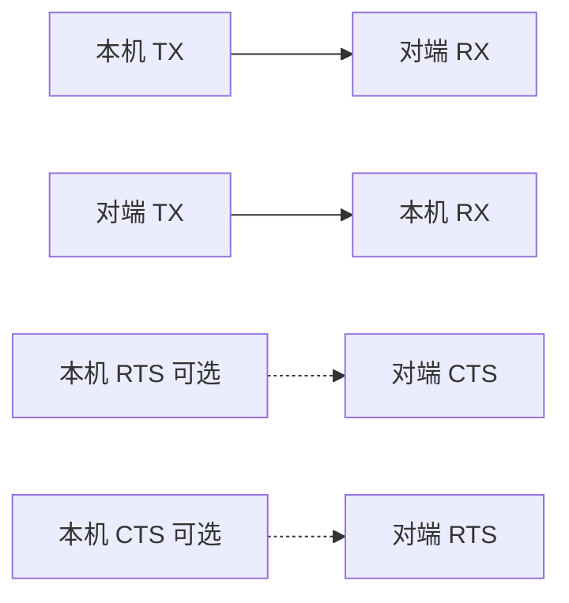

8N1 的一帧，空闲为高，低位先发：

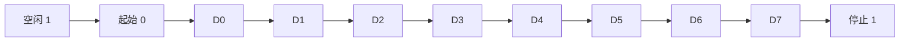

| 线 | 方向 | 作用 |
|----|------|------|
| TX | 本机 → 对端 | 发送 |
| RX | 对端 → 本机 | 接收 |
| RTS / CTS | 可选 | 硬件流控。RTS 表示本机还能收，CTS 表示对端允许本机发 |

空闲时线为高。一帧从一位低电平起始位开始，接着数据位（低位先发），可选校验位，最后 1 或 2 位高电平停止位。双方只靠预先约定的波特率对齐。偏差大约超过 2%–3% 就会在一帧末尾采错。本工程按 8 数据位、无校验、1 停止位，也就是 8N1；驱动打开后没有再改这三项，用的是控制器默认值。

波特率 = 位时钟 / 分频。位时钟从系统时钟来，不是从对端来。

#### 在 ADSP 里怎么配

用的是 `adi_uart`，设备号 0 就是 UART0。

| 接口 | 作用 |
|------|------|
| `adi_uart_Open(dev, dir, mem, size, &handle)` | 打开。`ADI_UART_DIR_BIDIRECTION` 是全双工，内存大小用 `ADI_UART_BIDIR_MEMORY_SIZE` |
| `adi_uart_ConfigBaudRate(handle, prescale, divisor)` | 写预分频和除数 |
| `adi_uart_RegisterCallback(handle, cb, arg)` | TX 完成等事件 |
| `adi_uart_DMARead(handle, desc, count, mode)` | 提交 RX DMA。列表模式用于环形缓冲 |
| `adi_uart_DMAWrite(handle, desc, count, mode)` | 提交 TX DMA。停止模式用于一次性发送 |
| `adi_uart_Close(handle)` | 关闭 |

DMA 描述符是 `ADI_PDMA_DESC_LIST`：`pStartAddr`、`XCount`、`XModify`、`pNxtDscp`。`XModify = 1` 表示按字节走。RX 剩余次数在通道的 `XCNT_CUR` 里，它是还没搬完的个数，不是写指针。

#### 当前配置

| 项 | 值 |
|----|-----|
| 管脚 | PA6 TX、PA7 RX、PA8 RTS、PA9 CTS，PORTA mux 功能 1 |
| 设备 | UART0，全双工 |
| 预分频 / 除数 | 1 / 136 |
| 波特率 | 按 SCLK0 = 125 MHz：125e6 / 136 ≈ 919118，相对 921600 低约 0.27%，是最近的整数除数 |
| 流控 | 管脚复用了 RTS/CTS，驱动没有打开硬件流控 |
| RX | 描述符指向自己，`XCount = 512`，循环 DMA。UART0 RX 是 DMA 通道 21，剩余次数用 `UART0_RXDMA_XCNT_CUR` |
| TX | 停止模式，单次最长 512 字节。完成事件把 `is_tx_over` 置 1 |
| 轮询 | TMR0 每 1 ms 调用 `Uart0Poll`，只更新写指针和 overrun |

写指针：`wr = 512 - min(XCNT_CUR, 512)`，若结果是 512 则改成 0。`XCNT_CUR == 0` 表示这一圈刚好写完，下一个字节落在下标 0。

`Uart0Wr` 拒绝空指针和 0 长度；超过 512 就分块，每块单独等完成。长度刚好是 512 的倍数时不再补一次长度为 0 的 DMA，否则完成中断不来，后面的发送会全部超时。

主循环协议是单字节，没有帧头：

| 字节 | 动作 |
|------|------|
| `0xAA` | 读 A2B 中断和误码。第二路监视函数是空的 |
| `0xBB` | 打印 UART underrun / overrun |
| `0xCC` | 打印 SHARC1 写在 `0x2003FF00` 的负载，格式 `d.ddd` |
| 其它 | 丢掉 |

`Uart0Rd` 在缓冲空时也把 underrun 加 1。主循环会一直读到空，所以空闲轮询也算进 underrun。

描述符和 512 字节环放在 `.l2_uncached_data`。ARM 的 D-cache 不能和 UART DMA 各看各的。

### 2.2 I2C / TWI

#### 协议

I2C 是同步总线，两根线，都是开漏，外部上拉：

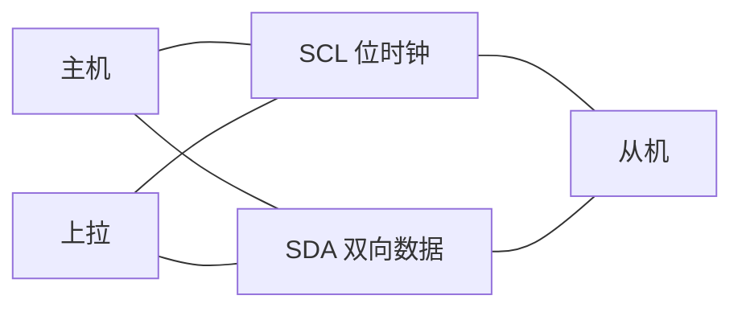

一次写寄存器，中间不重新寻址：


读寄存器要先写地址，再用重复 START 转成读：


| 线 | 作用 |
|----|------|
| SCL | 主机产生的位时钟 |
| SDA | 双向数据。主机和从机都能拉低 |

空闲时两根都是高。主机拉低 SDA 而 SCL 仍为高，是 START。主机在 SCL 为高时放开 SDA，是 STOP。数据只在 SCL 为低时改变，在 SCL 为高时被采样。

地址是 7 位，第 8 位是读写位：0 写，1 读。每个字节后面有一位 ACK，接收方拉低 SDA 表示收到。没有 ACK 就是 NAK，主机应 STOP。

写寄存器的常见帧是一次写，中间不重新寻址：

```text
START + 地址(W) + 寄存器地址 + 数据字节 + STOP
```

读则是写地址、重复 START、再读：

```text
START + 地址(W) + 寄存器地址 + 重复 START + 地址(R) + 数据 + NAK + STOP
```

重复 START 不是 STOP。如果把“寄存器地址”和“数据”拆成两次独立的寻址写，从机会把数据的第一个字节当成新的寄存器地址。

标准模式 100 kHz，快速模式 400 kHz。本工程用 100 kHz。SCL 高、低电平时间由占空比分开，本工程是 50%。总线上同时只能有一个主机。

#### 在 ADSP 里怎么配

SC59x 的 I2C 控制器叫 TWI。`adi_twi` 的设备号 2 就是 TWI2。

| 接口 | 作用 |
|------|------|
| `adi_twi_Open(dev, ADI_TWI_MASTER, mem, size, &handle)` | 以主机打开 |
| `adi_twi_SetPrescale(handle, prescale)` | 把内部时基收到大约 10 MHz。按 SCLK0 = 125 MHz，预分频是 12 |
| `adi_twi_SetBitRate(handle, khz)` | 目标速率，单位 kHz |
| `adi_twi_SetDutyCycle(handle, percent)` | SCL 占空比 |
| `adi_twi_SetHardwareAddress(handle, addr)` | 7 位从机地址 |
| `adi_twi_Write(handle, buf, len, restart)` | 写。`restart = true` 在末尾发重复 START，不发 STOP |
| `adi_twi_Read(handle, buf, len, restart)` | 读 |
| `adi_twi_Close(handle)` | 释放控制器 |

封装成这几层：`Twi2Open` / `Twi2Stop` / `Twi2IsIdle` 管总线所有权；`Twi2DevRegShtWr` / `Twi2DevRegShtRd` 是 8 位寄存器地址加 1 字节；`Twi2RegShtWr` / `Twi2RegShtRd` 沿用上一次设过的地址；`Twi2DevRegLngWr` 把 1、2 或 4 字节地址按大端和数据拼成一次写。

#### 当前配置

| 项 | 值 |
|----|-----|
| 管脚 | PA14 SCL、PA15 SDA，mux 功能 0 |
| 控制器 | TWI2，主机 |
| 速率 | 预分频 12，100 kHz，占空比 50% |
| 从机 | U6 `0x22`，ADAU1962 `0x04`，ADAU1979 `0x11`，AD24280 `0x68` / `0x69` |

每个从机用完都 `Twi2Stop`。`Twi2Open` 在忙时直接返回，避免第二次打开同一块驱动内存。`Twi2Stop` 在已经空闲时什么都不做。长写的数据最长 128 字节，地址和数据在同一次 `adi_twi_Write(..., false)` 里。

启动时的占用顺序：U6 → ADAU1962 → ADAU1979 → AD24280。监视命令 `0xAA` 会再次打开 TWI2 读 A2B，读完关掉。

### 2.3 定时器

#### 协议

这不是芯片外的通讯协议。通用定时器从 SCLK0 计数，数到周期就产生中断，然后在连续模式下重新计数。周期（秒）= 计数值 / SCLK0。1 ms 在 125 MHz 下是 125000 个 SCLK。

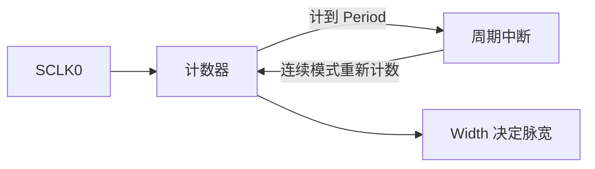

#### 在 ADSP 里怎么配

| 接口 | 作用 |
|------|------|
| `adi_tmr_Open(dev, mem, size, cb, arg, &handle)` | 打开并登记回调 |
| `adi_tmr_Config(handle, &cfg)` | 把 `ADI_TMR_CFG_PARAMS` 写进硬件。只填结构体不会生效 |
| `adi_tmr_Enable(handle, true/false)` | 启动或停止 |
| `adi_tmr_Close(handle)` | 关闭 |

`ADI_TMR_CFG_PARAMS` 里和周期有关的是 `Mode`、`ClkInSource`、`Period`、`Width`、`Delay`、`IRQMode`。

#### 当前配置

TMR0，连续 PWM 输出模式，中断在周期点，时钟源是系统时钟，周期 125000，脉宽是周期的 1/4，延时 0，允许优雅停止。回调里只处理 `ADI_TMR_EVENT_DATA_INT`，调用 `Uart0Poll`。

### 2.4 管脚复用

#### 原理

同一根 GPIO 可以接到 GPIO、UART、TWI 等不同功能。`PORTx_FER` 的一位为 1 时，该脚离开 GPIO，改由外设驱动。`PORTx_MUX` 每脚两位，选择功能号。功能 0 就是把这两位清掉。DAI 上的音频脚不经过 PORT mux，它们进 SRU。

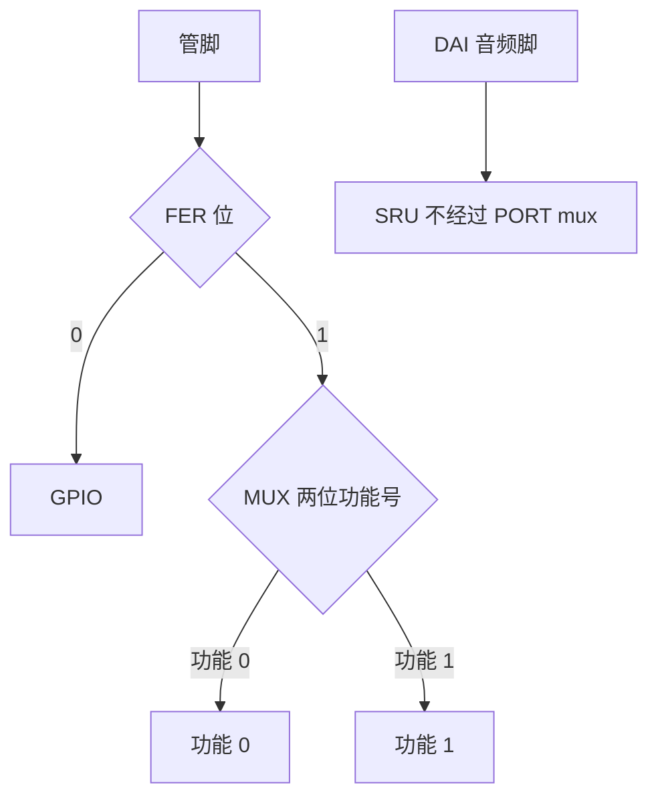

改 mux 必须读改写。整寄存器覆盖会把别的脚的功能清掉。

#### 在 ADSP 里怎么配

CCES 的 Pin Multiplexing 插件生成 `adi_initpinmux()`。本工程那个函数仍是 `return 0`。实际配置在 `BoardPinmux()`，直接写 `pREG_PORTA_MUX` 和 `pREG_PORTA_FER`。

#### 当前配置

| 功能 | 脚 | MUX 位移 | 功能号 | FER 位 |
|------|----|----------|--------|--------|
| UART0 TX | PA6 | 12 | 1 | bit 6 |
| UART0 RX | PA7 | 14 | 1 | bit 7 |
| UART0 RTS | PA8 | 16 | 1 | bit 8 |
| UART0 CTS | PA9 | 18 | 1 | bit 9 |
| TWI2 SCL | PA14 | 28 | 0 | bit 14 |
| TWI2 SDA | PA15 | 30 | 0 | bit 15 |

这和 SC594 EZ-KIT 的 UART ALT1、I2C2 ALT0 一致。

### 2.5 SPU

#### 原理

系统保护单元决定哪个总线主机可以访问哪一个外设或 DMA 通道。安全主机没被放行时，DMA 访问会被挡掉，表现为通道不走或故障，而不是通讯协议错误。

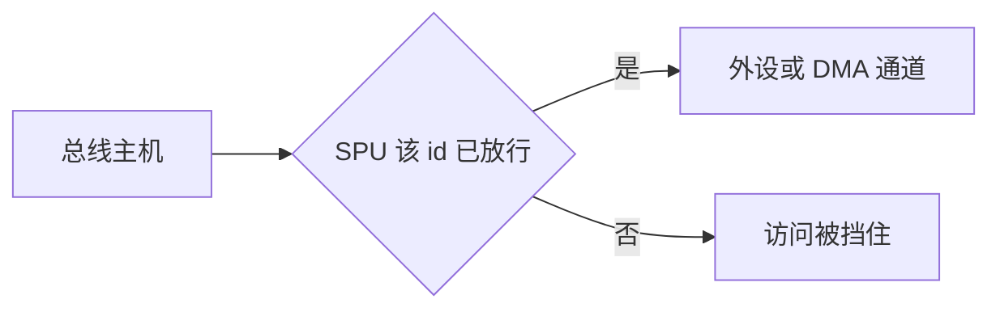

编号在这颗片子上是连续的：半 SPORT 从 SP0A = 63 起，每个半 SPORT 加 1，到 SP7B = 78；紧接着 UART0 RX DMA = 79，TX DMA = 80。UART0 控制器本身是 29。

#### 在 ADSP 里怎么配

| 接口 | 作用 |
|------|------|
| `adi_spu_Init(dev, mem, cb, arg, &handle)` | 打开 SPU0 |
| `adi_spu_EnableMasterSecure(handle, id, true)` | 允许安全主机访问该 id |

#### 当前配置

放行 9 个 id：SPORT1A/B = 65/66，SPORT4A/B = 71/72，SPORT5A/B = 73/74，UART0 = 29，UART0 RX/TX DMA = 79/80。21593 上打开的是 SPORT0 和 SPORT2（63–68）。本工程换了 SPORT 号，所以 id 跟着换。DMA 异常时先拿 DFP 里的 SPU 枚举对这张表，不要先改 SRU。

### 2.6 U6 GPIO 扩展器

#### 规格

U6 是载板 EV-SOMCRR-EZKIT 上的 Microchip **MCP23017**，原理图封装是 QFN-28。载板手册写了两颗这种扩展器，本工程只配置地址 `0x22` 的这一颗。

| 项 | 规格 |
|----|------|
| 口 | 16 位 GPIO，端口 A、端口 B 各 8 位 |
| 控制 | I2C，支持 100 kHz、400 kHz 和 1.7 MHz。地址由 A2:A0 决定，基址 `0x20`。U6 的地址线接成 `0x22` |
| 上电 | 脚默认是输入。要当输出用，先把电平写进锁存，再把对应 IODIR 位清 0 |
| 中断 | INTA、INTB 两路输入变化中断。本工程不接这两根中断，只当软开关用 |

#### 协议

这是挂在 I2C 上的 16 位 GPIO，地址 `0x22`。寄存器布局和 MCP23017 一类器件一致：`0x00` / `0x01` 是端口 A/B 的方向（1 = 输入），`0x12` / `0x13` 是端口 A/B 的输出锁存。先写锁存，再把方向改成输出，脚从输入变成输出时不会先冒一个复位毛刺。

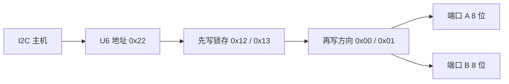

端口 A 的位（低有效的用 `~` 表示）：

| 位 | 信号 |
|----|------|
| 7 | ~ADAU1979_EN |
| 6 | ~ADAU1962_EN |
| 5 | ~ADAU_RESET |
| 2 | ~MicroSD_SPI |
| 1 | PUSHBUTTON_EN |
| 0 | EEPROM_EN |

端口 B 含以太网复位、插孔选择、SPDIF 使能等。固件按表写入，不在这里再解释每一位的板级电源树。低有效信号写 0 是“生效”。

#### 在 ADSP 里怎么配

没有单独的 GPIO 扩展器驱动库。用上一节的 TWI 短写：`Twi2DevAddrSet(0x22)` 之后 `Twi2RegShtWr(reg, val)`。

#### 当前配置

分两步。

上电锁存：端口 A `0x12 = 0x05`（1962/1979 使能，复位仍按住），端口 B `0x13 = 0xFD`，方向 A `0x00 = 0x18`，方向 B `0x01 = 0x00`。

释放复位：端口 A `0x12 = 0x25`（bit5 拉高，~ADAU_RESET 放开），方向再写一次。然后 `Twi2Stop`，再空等至少 300 ms。ADAU1962A Rev. A 要求 PU/RST 拉高后 300 ms 才保证稳定。ARM 没有 `__builtin_emuclk`，这里用 `volatile` 计数 3×10^8 次 `nop`。CCLK 不超过 1 GHz 时，这段不会短于 300 ms。

### 2.7 SRU

#### 原理

SRU 是片上的信号开关，不是一根对外的总线。它把 DAI 脚、SPORT 时钟和数据交叉连接。每一路连接都有方向：源是 `_O`，目的是 `_I`。脚的输入/输出由 `PBENx` 决定。

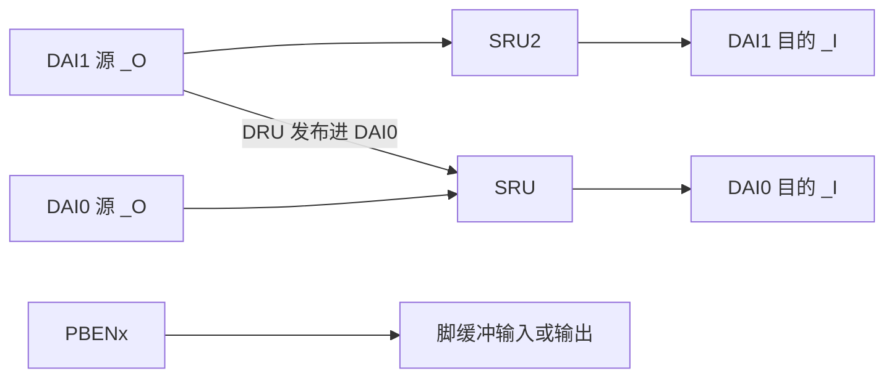

两组开关不能混用：DAI0 的目的用 `SRU`，DAI1 的目的用 `SRU2`。DAI1 的源可以出现在 DAI0 的 `SRU` 里，这是 DRU 把 DAI1 信号发布进 DAI0 开关。时钟可以一对多扇出。一根数据脚只接一个源。

#### 在 ADSP 里怎么配

`sru.h` 的宏在编译期展开成寄存器写。`adi_SRU_Init()` 来自生成文件，默认只打开 DAI 输入焊盘。`SruInit()` 再写具体连接，并再写一次 `PADS0_DAI0_IE` / `DAI1_IE`。

#### 当前配置

连接表就是第 1.4 节。实现在 `arm0/src/driver/sru/signal_route.c`。不要定义 `SRU_FULL_INIT`。

### 2.8 SPORT / TDM

#### 协议

TDM 是同步串行音频。至少三根线，多路数据时再加数据线：

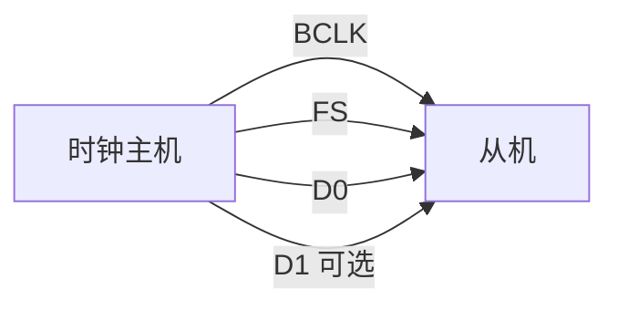

TDM16 的一帧从 FS 开始，后面是 16 个槽：


| 线 | 作用 |
|----|------|
| BCLK | 位时钟。一个周期移一位。主机产生 |
| FS | 帧同步。标出一帧的起点，帧内有固定个槽 |
| D0、D1… | 数据。每个槽通常 32 个 BCLK，槽里是一个采样 |

经典 I2S 是 TDM 的两槽特例：FS 是声道选择，左右声道各一个槽，数据相对 FS 晚一个 BCLK。本工程不是 I2S，是 TDM16：一帧 16 个槽，FS 是帧起点（early FS，数据不晚一拍），FS 高有效、边沿敏感。

谁产生 BCLK/FS，谁就是时钟主机。从机只在约定的沿上采样。本工程全部 SPORT 都是从机，主机是 ADAU1962。沿必须和主机一致，否则整帧错一位。两根数据线表示两个独立的 TDM16 流，在同一个 BCLK/FS 下并行，合成 32 槽，不是把一帧加长到 32 个 BCLK 槽那么简单；SPORT 侧仍按 32 个槽窗口来收两根线。

字长 32 位、高位先发、符号扩展。槽与槽之间没有额外的帧延迟以外的空洞；`nFrameDelay = 1` 是相对 FS 的槽延迟，和 early FS 配在一起用。

#### 在 ADSP 里怎么配

SHARC 的 `adi_sport`。半 SPORT A 和 B 可以共用一个 SPORT 号，时钟可以分开配。

| 接口 | 参数含义 |
|------|----------|
| `adi_sport_Open(dev, half, dir, ADI_SPORT_MC_MODE, mem, size, &h)` | 多通道模式打开。`dev` 是 SPORT 号 |
| `adi_sport_ConfigData(h, dtype, nWordLength, bLSBFirst, bEnablePack, bRightJustified)` | `nWordLength` 是位数减 1。31 表示 32 位 |
| `adi_sport_ConfigClock(h, nClockRatio, bUseIntlClock, bFallingEdge, bGatedClk)` | `bUseIntlClock = false` 才是外部 BCLK。第四个参数是下降沿，不是上升沿 |
| `adi_sport_ConfigFrameSync(h, nFsDivisor, bFSRequired, bInternalFS, bDataFS, bActiveHighFS, bLateFS, bEdgeSensitiveFS)` | `bInternalFS = false` 使用外部 FS。`bLateFS = false` 是 early FS |
| `adi_sport_ConfigMC(h, nFrameDelay, nNumSlots, nWindowSize, bEnableDMAPack)` | 多通道槽 |
| `adi_sport_SelectChannel(h, start, end)` | 使能的槽范围 |
| `adi_sport_DMATransfer(h, desc, nDesc, list, channel)` | `ADI_SPORT_CHANNEL_PRIM` 只用 D0；`PRIM_SEC` 用 D0 和 D1 |
| `adi_sport_CreateGlobalGroup` / `GlobalRegisterCallback` / `GlobalEnable` | 多路 SPORT 对齐成一组，共用一个缓冲完成回调 |
| `adi_sport_Enable(h, true)` | 打开这一路。组使能前后各做一次，避免半开 |

DMA 描述符两块乒乓，`XModify = 4`（32 位一字）。完成时 `adi_sec_Raise(INTR_TRU0_INT4)`，另一侧 `adi_int_InstallHandler` 跑 `AudioProcess`。

#### 当前配置

六路全是外部时钟、外部 FS、32 位、MSB、early、高有效、边沿敏感 FS。`nFsDivisor = 31`。`nFrameDelay = 1`，`nWindowSize = 0`，DMA 打包打开。

| 半 SPORT | 方向 | 数据线 | 槽 | `bFallingEdge` | 角色 |
|----------|------|--------|----|----------------|------|
| SPORT4A | TX | D0 | 0–15 | true | DAC |
| SPORT4B | RX | D0 | 0–15 | false | ADC |
| SPORT1A | TX | D0+D1 | 0–31 | false | A2B0 下行 |
| SPORT1B | RX | D0+D1 | 0–31 | true | A2B0 上行，沿与 1A 错开 |
| SPORT5A | TX | D0+D1 | 0–31 | true | 遗留 A2B1 |
| SPORT5B | RX | D0+D1 | 0–31 | true | 遗留 A2B1 |

`nNumSlots` 传入 15 或 31，`SelectChannel` 的结束槽也是 15 或 31。缓冲在 SHARC L1 block 1，和 DMA 同核，不经过 ARM 缓存。

### 2.9 ADAU1962

#### 规格

载板上的 DAC 是 **ADAU1962A**（数据手册 Rev. A）。它是 12 通道、24 位、Σ-Δ DAC，80 脚 LQFP。

| 项 | 规格 |
|----|------|
| 通道 | 12 路电压输出，可差分或单端。差分动态范围 114 dB（A 计权），THD+N −97 dB |
| 采样率 | 32 kHz–192 kHz。过采样在 48 kHz 档是 256×，96 kHz 档 128×，192 kHz 档 64× |
| 时钟 | 片上 PLL，也可以直接用主时钟。主机或从机。右对齐、左对齐、I2S、TDM。最多 12 通道从一根 TDM 线进去，也可以用 6 根数据线、每根两通道 |
| 控制 | SPI 或 I2C。本板用 I2C，地址 `0x04`。每通道音量 255 级，步进 0.375 dB，可自动斜坡。可软件静音和掉电 |
| 电源 | 数字 2.5 V，模拟和 I/O 3.3 V。片上线性稳压器可以从模拟电源产生数字电源。静态功耗 249 mW |
| 模拟脚 | AVDD = 3.3 V 时共模约 1.5 V。0 dBFS 时每脚约 ±1.42 V 峰值 |

#### 协议

ADAU1962A 是多通道 DAC，控制口是 I2C 从机，地址 `0x04`。音频口是 TDM 时钟主机：芯片用 MCLK（本板 24.576 MHz）锁相，再送出 BCLK 和 FS。512 × 48 kHz = 24.576 MHz，所以 PLL 配成 512×fs 时，48 kHz 帧和这块晶振对齐。

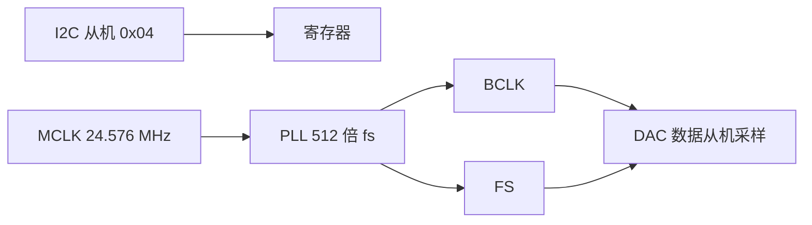

TDM16、32 位槽、高位先发时，BCLK = 48 kHz × 16 × 32 = 24.576 MHz，和 MCLK 同频。从机（ADC、A2B、SPORT）都跟这个时钟。

PU/RST 拉高之后要等它稳定，再写寄存器。PLL 锁定是读 `PLL_CLK_CTRL1` 的 bit 2，这位只读。

#### 在 ADSP 里怎么配

没有 codec 专用库。`Adau19620Init` 用 TWI 短写按表播放，写完再读回比较。`Adau1962ClkReady()` 只有在看到锁定位之后才返回 1。

#### 当前配置

PLL 表：`PLL_CLK_CTRL0` 先 `0x01` 再 `0x05`，`PLL_CLK_CTRL1 = 0x22`。`0x05` 是 512×fs。

数据格式在锁定之后写。`DAC_CTRL1 = 0x43`：高位先发、下降沿采样、主机、32 位。`DAC_CTRL2 = 0x00`：256×fs 过采样。最后 `DAC_CTRL0 = 0x20`：TDM16、48 kHz、通道打开。静音和音量都是 `0x00`。电源寄存器在格式写好之后从掉电值改到运行值。

### 2.10 ADAU1979

#### 规格

载板上的 ADC 是 **ADAU1979**（数据手册 Rev. B）。四通道、24 位 Σ-Δ ADC，40 脚 LFCSP。单电源 3.3 V，内部再产生数字 1.8 V。

| 项 | 规格 |
|----|------|
| 输入 | 四路，可差分或单端。差分满幅典型 4.5 V rms。共模约 1.5 V |
| 性能 | 动态范围典型 109 dB（A 计权）。THD+N 典型 −95 dB。通道隔离典型 100 dB |
| 采样率 | 串口输出 8 kHz–192 kHz。片上 PLL 可以从主时钟或帧时钟锁相 |
| 音频口 | 主机或从机。右对齐、左对齐、I2S、TDM。两根数据线各带一对立体声，也可以收进一根 TDM 线（TDM 帧最多标到 16 个槽） |
| 控制 | I2C 或 SPI。本板用 I2C，地址 `0x11`。每通道数字增益 0–60 dB，带自动斜坡。可选数字高通。可软件静音和掉电 |

#### 协议

ADAU1979 是四通道 ADC，I2C 地址 `0x11`。音频口是 SAI 从机：它不产生 BCLK/FS，采样沿和 FS 极性必须和 DAC 主机一致。FS 字段和采样率段是绑在一起的，配错会把 48 kHz 写成 64–96 kHz 那一档，锁定和槽宽都会错。

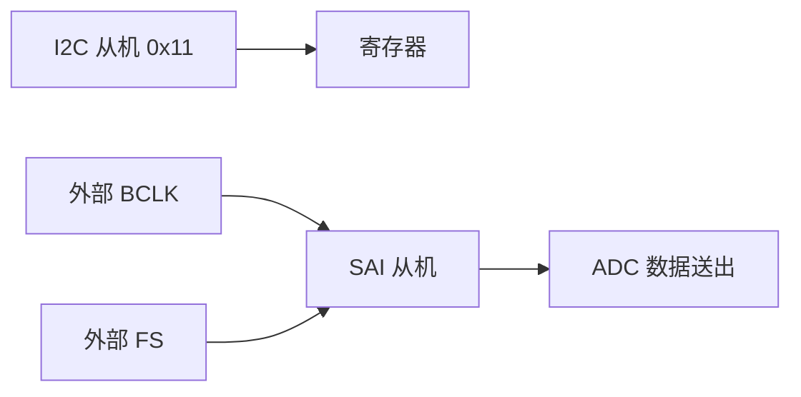

锁定在 PLL 控制寄存器的 bit 7。`PLL = 0x03` 表示 512×fs、32–48 kHz 的主时钟分频。

#### 在 ADSP 里怎么配

同样是 TWI 表播放：`Adau19790Init`。

#### 当前配置

`SAI_CTRL0 = 0x22`：SAI 模式 `100` 是 TDM16，FS 字段 `010` 是 32–48 kHz。`0x23` 会把 FS 写成 `011`（64–96 kHz），不要改回去。`SAI_CTRL1 = 0x08`。上电时先 `BLOCK_POWER_SAI = 0x70`（静音），格式写完后 `0x7F`（全部打开）。`CMAP12 = 0x01`、`CMAP34 = 0x23` 相对复位值交换了相邻通道，目前按表保留。后级增益四路都是 `0xA0`。

### 2.11 AD2428 / A2B

#### 规格

A2B 收发器是 **AD2428**（AD2420/AD2426/AD2427/AD2428/AD2429 数据手册 Rev. D）。它既能当主节点，也能当从节点。AD2426 / AD2427 不能当主节点。

| 项 | 规格 |
|----|------|
| 总线 | 一根 100 Ω 差分双绞线。主节点产生时钟、同步和超帧。AD2428 做主节点时，最多再挂 10 个从节点；节点间距最长 15 m，全链最长 40 m |
| 音频槽 | 上行、下行各最多 32 槽。槽宽 8–32 位，全网同一宽度；上行和下行可以选不同宽度。I2S / TDM 接到主机 |
| 采样 | 全网同步。超帧通常 48 kHz（也支持 44.1 kHz）。从节点可以单独配成 1× / 2× / 4×，也就是 48 / 96 / 192 kHz。超帧比特率是采样率的 1024 倍，48 kHz 时是 49.152 MHz |
| 延迟 | 从一端的 I2S/TDM 到另一端的 I2S/TDM，略多于两帧，再加收发器和线长。48 kHz 时小于 50 μs |
| 控制 | 主节点用 I2C 配置。同一条差分线里嵌着到从节点的 I2C、GPIO 和中断。本板主节点地址 `0x68`，总线地址 `0x69` |
| 其它 | 最多 4 路 PDM 麦。可总线供电或从节点本地供电。发现一个节点不到 35 ms |

A2B 是一条菊花链。物理层是一对差分线（A 侧 / B 侧），上面同时跑同步音频和嵌入的控制通道。主节点产生或转发超帧；从节点在发现流程里依次得到地址。

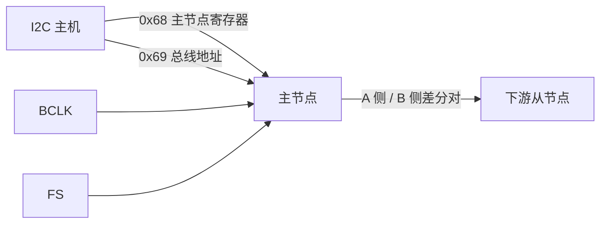

配置不走差分线本身的音频槽，而走主节点的 I2C。主节点有两个 7 位地址：一个是主节点自身寄存器（`0x68`），一个是总线地址（`0x69`），用来访问下游节点。SigmaStudio 导出的脚本是一串操作：写寄存器、读寄存器、延时。延时是 1 字节，或 16 位大端。发现（DISCVRY，寄存器 `0x13`）之后要等完成中断：主节点跑起来是 INTTYPE 255，从节点发现完成是 INTTYPE 24。

发现能成功的前提是 BCLK/FS 已经在跑。A2B 收发器用这个时钟生成超帧，它自己不是板级的音频时钟源。USBi 只是另一个 I2C 主机，插在同一条 TWI 上时，固件不能再当主机。

#### 在 ADSP 里怎么配

`Ad24280Init` 在时钟就绪且 TWI 空闲时回放 `ad24280_cfg`。`Ad2428Cfg` 按操作码调用 TWI 短写、长写、短读或延时。`Ad24280Mon` 读 INTSRC、INTTYPE、误码计数并清误码。`Ad24281Init` 不在启动路径里调用。

#### 当前配置

只启用 AD24280。地址 `0x68` / `0x69`。表是 SigmaStudio 导出，829 条，宽度和长度都是 1，15 条延时也都是 1 字节。`val_width > 1` 会立刻停表。第一条延时（下标 1）轮询主节点运行；前一条寄存器是 `0x13` 的延时轮询从节点发现完成。

AD24281（`0x6C` / `0x6D`）是空桩。载板没有第二颗主节点。SPORT5 那些 DAI1 脚仍然按遗留网络接好，没有器件响应。

---

## 3. 补充

### 3.1 USBi：先有时钟，再占 I2C

1. `SruInit` 和 `Adau19620Init` 完成之后才允许 `Ad24280Init` 打开 TWI2。代码里用 `Adau1962ClkReady()` 守住这一点。
2. 每个 TWI 用户在下一个用户打开之前关掉总线。NAK 不能留给后面的 A2B 长脚本。
3. 从 `Sw0Init` 到 `Ad24280Init` 这段不要插着 USBi。软件看不出它还在总线上。
4. 要重新导出 SigmaStudio 表：跑到 1962 时钟已经出来，先不要进 `Ad24280Init`，再插 USBi。拔掉之后固件才能再次打开 TWI2。

### 3.2 生成文件里不要动的开关

- 不要定义 `SRU_FULL_INIT`。
- `adi_initpinmux()` 保持空函数。控制脚只在 `BoardPinmux()` 里改。
- 不要把 21593 的 `app.ldf` 或 pinmux 拷进来。MCAPI、ARM 链接脚本、SHARC 启动桩保持本工程生成的版本。`*.ldf` 不进 git。缺 `sharc1/system/startup_ldf/app.ldf` 或 `sharc2` 那一份时，在 CCES 里打开对应 `system.svc`，重新生成 Startup Code/LDF（本仓库记录的工具版本是 6.3.2）。

### 3.3 ARM 和 SHARC 的差异

- UART DMA 缓冲放在非缓存 L2。SHARC 那套 `seg_l1_block1` pragma 不能用在 ARM 编译器上。
- `NULL` 要自己包含 `<stddef.h>`。ARM gcc 不会从 `<stdint.h>` 提供它。
- 忙等用 `BUSY_NOP()`（`__asm__ volatile("nop")`）。`asm("nop;")` 是 SHARC 的写法。
- SHARC 把 `AudioStat` 写回用 `flush_data_buffer(..., ADI_FLUSH_DATA_NOINV)`。这个宏在 `sys/cache.h` 里，意思是写回、不作废。没有 `FLUSH_DATA_BUFFER_NO_INV` 这个名字。
- SHARC 编译必须 `-char-size-8`，否则 `uint8_t` 不是 8 位，和 ARM 的结构体会错位。

### 3.4 还没做完的事

- `tune.c` 能解析帧，但 `MonTmp` 没有调用 `TuneRx`。监视仍是单字节 `0xAA` / `0xBB` / `0xCC`。
- SPU 编号按半 SPORT 连续推出来，DMA 如果故障，先对 DFP 枚举。
- SCLK0 若被以后的 CGU 改掉，UART 除数 136 和 TMR 周期 125000 要一起改。
- 两份 `audio_stat.h` 改字段或地址时要同时改。

### 3.5 构建

CCES 3.0.3，处理器 ADSP-SC594，硅版本 0.0。导入 `arm0`、`sharc1`、`sharc2`，不要改成 21593。Debug 产物在各自的 `Debug/` 目录：ARM 映像名是 `arm0`（生成规则没有加 `.dxe`），两个 SHARC 是 `sharc1.dxe`、`sharc2.dxe`。这些目录和 `_cces_*.log` 不进 git。

头文件路径：ARM 是 `system`、`src/driver`、`src/algo`；SHARC1 是 `system`、`src/driver`。`adi_uart`、`adi_twi`、`adi_sport`、`adi_tmr`、`adi_spu`、`sru.h` 来自 CCES 的 Device Family Pack，不放在本仓库里。已核实的缺陷和这次 Debug 构建的记录在 `doc/bugs.md`。
